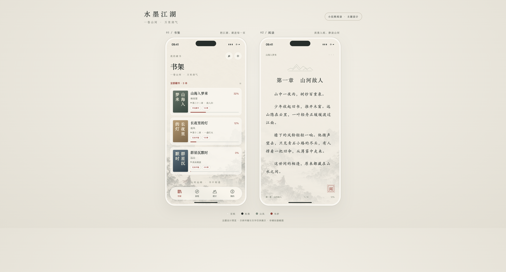

# 水墨江湖

小浣熊阅读的可选主题，参考用户提供图片中的宣纸、水墨山水、朱砂和通透控件。



预览为设计稿，示例书籍与文字仅供展示，不是模拟器截图。实际 App 保留系统状态栏、原生导航栏、现有阅读排版与书籍内容。

## 使用

- 在「我的 → 主题」预览并应用「水墨江湖」。
- 应用后使用列表书架；仍可在书架菜单切换网格或紧凑列表。
- 可选择同时应用阅读配色。正文阅读器使用淡化至 18% 的原创山水背景；EPUB 使用相同纸色与墨色，保留原书排版设置。
- 主题页提供「恢复之前的主题」，恢复应用前的外观、书架布局和阅读配色。已经另行修改的阅读配色与布局会予以保留。
- 正文的水墨阅读背景也可在「阅读设置 → 阅读背景」单独选择；EPUB 在「EPUB 排版 → 背景」选择。
- E-Ink 模式继续使用纯白底与黑字。

## 视觉

| 元素 | 色值 / 处理 |
| --- | --- |
| 宣纸底色 | `#F2EDE3` |
| 松墨正文 | `#252E2B` |
| 朱砂强调 | `#9B3631` |
| 卡片底色 | `#FAF7F0`，书架卡片 74% 不透明度 |
| 分隔线 | `#D9D5CA` |
| 山水背景 | 书架 / 发现 / 统计 38%，正文 18% |
| 字体 | 页面标题使用系统衬线字形；保留用户的正文字体、字号和段落设置 |
| 导航 | 保留原生标签栏行为；水墨主题使用书卷、罗盘、山峰和印章图标 |

## 资源

- 背景：`App/Assets.xcassets/InkLandscape.imageset/ink-landscape.png`
- 主题页：`App/Features/Settings/AppThemeView.swift`
- 可在浏览器打开的响应式设计稿：`docs/ink-theme-preview.html`
- 原生外观值：`themeMode = "4"`；正文与 EPUB 阅读配色值：`"ink"`。
- 使用内置 `image_gen` 工具生成原创背景，未使用 CLI / API 回退。

最终生成提示词：

```text
Use case: stylized-concept. Asset type: background artwork for a native Chinese novel reading app theme called 水墨江湖. Create an ORIGINAL tall portrait Chinese ink-wash landscape painting on warm ivory xuan rice paper, approximately #F2EDE1. Composition: upper 65 percent nearly empty warm paper with extremely subtle organic paper fibers and faint mist, to support black reading text. In bottom 35 percent, pale layered Chinese mountain silhouettes, a small traditional pavilion on the right shoreline, water and a tiny solitary swordsman silhouette on rocky bank near lower left, a few fine pine branches from bottom left. Beautiful refined hand-painted ink wash, very soft feathered mist dissolving into the paper above, gray-green ink, muted charcoal, extremely restrained tiny cinnabar accent on swordsman's cloak. All scenery must be LOW CONTRAST, airy, ethereal and faded, suitable behind text, no strong black areas. Edge-to-edge paper, no border. No text, no calligraphy, no signature, no watermark, no UI, no phone mockup. Portrait 1024x2048 or similar tall aspect ratio.
```
